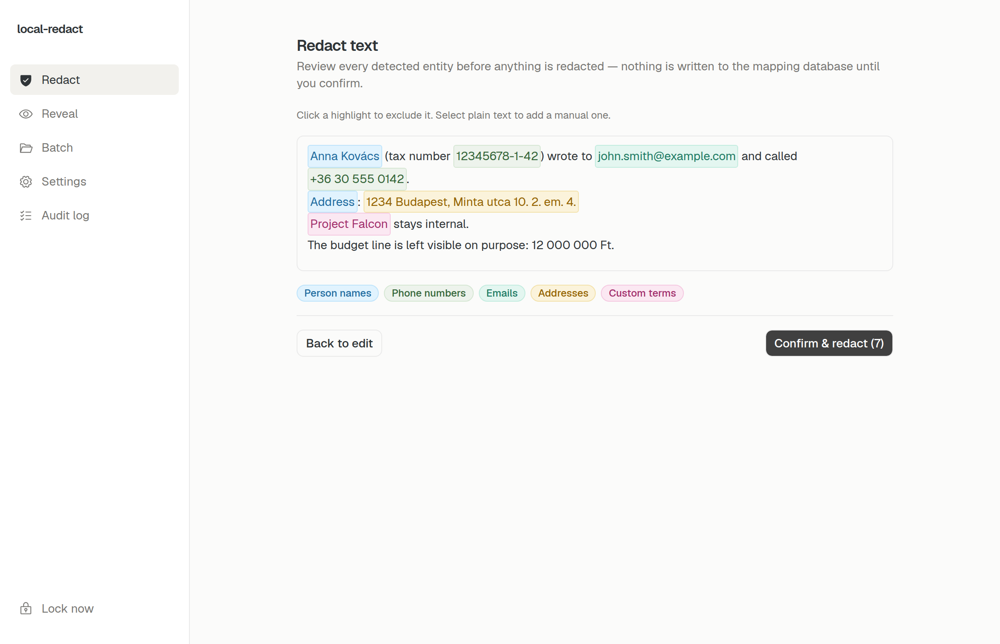

# local-redact

Redact sensitive text on your own machine before it goes to a cloud AI, then put the real values back when the reply comes home.

The mapping of placeholders to real values stays in an encrypted database on the computer that runs the tool. This repository does not send documents anywhere.



## Features

- Bilingual detection (Hungarian and English on every document): person names, organizations, emails, phone numbers, addresses, and national ID / tax numbers.
- Hungarian patterns for tax numbers, TAJ, personal ID, and company registration numbers, plus a labeled generic ID pattern.
- A custom term list (project codenames, internal names) that is always redacted, independent of the NER score.
- Stable placeholders (`PERSON_00001`, `ORG_00002`, …) so the same value keeps the same token across a document and across later files.
- Review before commit for pasted text and for `.txt`, `.md`, and `.csv`. Other formats are redacted with the current settings and reported by entity count.
- Reveal: paste a reply that still contains placeholders and restore the original values from the local database.
- Batch mode over a folder. Unsupported or unreadable files are reported and are not copied through unredacted.
- Hash-chained local audit log.

Financial amounts and dates are **off** by default. They are often the context you still want a model to see. Turn them on per session if you need to.

## How it works

One Python core is used by a CLI and a local web app.

1. You unlock a SQLCipher database with a passphrase (environment variable, OS keychain, or a prompt).
2. Presidio runs two spaCy models, `en_core_web_lg` and `hu_core_news_lg`, plus the Hungarian regex recognizers and your custom terms.
3. For text, you accept, drop, or add spans. Nothing is written to the mapping database until you confirm.
4. Confirm replaces each accepted span with a stable placeholder and stores the real value locally.
5. Reveal substitutes those placeholders back.
6. Word, Excel, PowerPoint, PDF, and email files are redacted in their own structure (cells, paragraphs, shapes, PDF text, message headers and body). Excel formulas are left unchanged.

The OpenWebUI integration described in the design notes is not built.

## Privacy

What this program actually does:

- Document text is processed locally. The Python package and the web UI do not call an AI provider, and the UI's only `fetch` is to `/api` on the same machine.
- The web server binds to `127.0.0.1:8420` only.
- The mapping database is SQLCipher-encrypted. A wrong passphrase fails closed: the CLI exits and the API returns 401. Opening a missing database does not silently create a new one.
- The passphrase is not written into the database or the repo. It can live in `LOCAL_REDACT_PASSPHRASE`, the OS keychain (`local-redact` / `db-passphrase`), or a prompt.
- Redact and reveal audit entries store a SHA-256 of the input, plus counts. They do not store the document text or the replaced values.
- Adding or removing a custom term records that term in the audit log. The term is already stored in the encrypted database, and the audit screen shows it.
- Batch audit entries record the local input and output folder paths.
- Corrupt or unsupported files are not copied to the output as-is.
- PDF redaction uses PyMuPDF redaction annotations (`add_redact_annot` + `apply_redactions`), not a box drawn on top of the text. If a detected string cannot be located on the page, that file is marked `partial` instead of reported as clean.
- Temporary files the server creates are overwritten and deleted when the download is taken or the session locks. That is best-effort: copy-on-write disks and SSDs can retain data the overwrite does not reach.

What this program does not do:

- It does not promise that every sensitive string will be found. NER misses ambiguous words, unusual addresses, and context that is sensitive without being a named entity ("our northern competitor"). Review the highlights. A second local-model pass is described in the design notes and is not implemented.
- It does not stop you from pasting the redacted text into a website yourself. Placeholders still describe the shape of the document.
- It is a single-user local app. Anyone who can use your logged-in session and who has the passphrase can unlock it. Localhost binding does not stop other software on the same machine.
- The audit hash chain shows tampering after the fact. Someone who has the passphrase can rewrite the database.
- `.xlsx` formula strings are not rewritten, so a name inside a formula can remain.
- `.msg` files are converted to `.eml`. Python cannot write a valid Outlook `.msg`.
- In `.docx` and `.pptx`, a redacted span keeps the first run's formatting and drops the rest of that span's character formatting.

## Tech stack

- Python 3.10+: [Presidio](https://microsoft.github.io/presidio/), spaCy, HuSpaCy, SQLCipher (`sqlcipher3`), python-docx, openpyxl, python-pptx, PyMuPDF, extract-msg, FastAPI
- Web: Next.js 16, React 19, Tailwind CSS 4

## Quick start

Python 3.12 is what the tests run on. You need both spaCy models; the Hungarian wheel from Hugging Face has to be renamed before `pip` will install it.

```bash
python3 -m venv .venv
.venv/bin/pip install -U pip
.venv/bin/pip install -e ".[dev]"
.venv/bin/python -m spacy download en_core_web_lg
curl -fsSL -o /tmp/hu_core_news_lg-3.8.0-py3-none-any.whl \
  "https://huggingface.co/huspacy/hu_core_news_lg/resolve/v3.8.0/hu_core_news_lg-any-py3-none-any.whl"
.venv/bin/pip install /tmp/hu_core_news_lg-3.8.0-py3-none-any.whl
```

The database defaults to the platform user-data directory. Override it with `--db` or `LOCAL_REDACT_DB`.

```bash
export LOCAL_REDACT_PASSPHRASE='choose-a-passphrase'
export LOCAL_REDACT_DB="$PWD/.local/mapping.db"

.venv/bin/local-redact init
.venv/bin/local-redact categories
.venv/bin/local-redact terms --add "Project Falcon"
.venv/bin/local-redact redact-text -i memo.txt -o memo.redacted.txt
.venv/bin/local-redact reveal -i reply.txt -o reply.restored.txt
.venv/bin/local-redact redact report.docx -o report.redacted.docx
.venv/bin/local-redact batch ./incoming ./redacted-output
.venv/bin/local-redact audit
```

`wipe` deletes mappings, terms, and settings. It refuses to run without `--yes`.

### Web app

In one terminal, from `web/`:

```bash
pnpm install
pnpm dev
```

In another, from the repo root (same passphrase and database as above):

```bash
.venv/bin/local-redact-web
```

Open `http://localhost:3000`. Dev mode proxies `/api` to `127.0.0.1:8420`.

A production build is a static export served by the same process, still on localhost:

```bash
cd web && pnpm build
cd .. && .venv/bin/local-redact-web
```

Then open `http://127.0.0.1:8420`.

Supported formats: `.txt`, `.md`, `.csv`, `.docx`, `.xlsx`, `.pptx`, `.pdf`, `.eml`, `.msg` (written out as `.eml`).

## Development

```bash
.venv/bin/python -m pytest tests/ -q -m "not slow"
cd web && pnpm lint && pnpm exec tsc --noEmit && pnpm build
```

`pytest -m slow` runs a larger synthetic batch. Engine tests load the real spaCy models once per session.

Design notes live in `docs/specs/`. They describe intended behavior, including the OpenWebUI front end that is not in this repo.

## License

[MIT](LICENSE).
